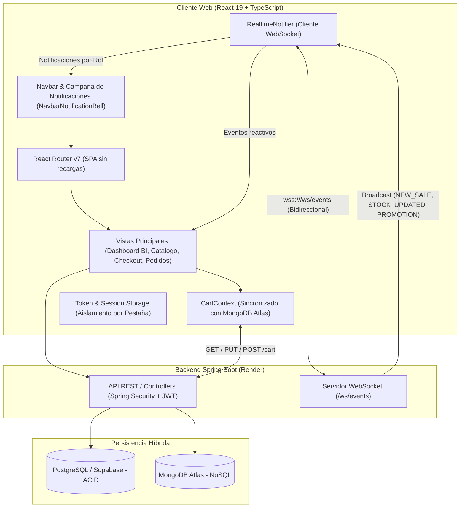

# Hurios Rally - Frontend Web Application & Real-Time Client

Aplicación Frontend moderna, responsiva y de alto rendimiento construida con **React 19, TypeScript, Vite y Tailwind CSS** para el e-commerce de repuestos automotrices **Hurios Rally E.I.R.L.** Se comunica con el Backend en Spring Boot mediante **REST API (JWT)**, pasarela de pagos con **MercadoPago Checkout Pro**, persistencia híbrida en la nube (**PostgreSQL + MongoDB Atlas**) y sincronización bidireccional en tiempo real mediante **WebSockets**.

- **URL Desplegada (Render):** `https://huriosfrontend-desarrollofullstack.onrender.com`
- **Backend API Conectado:** `https://huriosbackend-desarrollofullstack.onrender.com`
- **Documentación Swagger / OpenAPI:** `https://huriosbackend-desarrollofullstack.onrender.com/documentacion`

---

## 1. Arquitectura del Frontend y Flujo en Tiempo Real

El sistema está diseñado bajo una arquitectura de componentes modulares, estado global desacoplado y comunicación reactiva orientada a eventos para habilitar **pruebas de espejo en tiempo real** entre sesiones simultáneas de Administrador y Cliente:



---

## 2. Características Implementadas (Avance 2)

### A. Dashboard de Inteligencia Comercial y Control en Tiempo Real (`AdminProfile.tsx`)
- **Acceso directo para Administradores:** Al iniciar sesión con rol `ADMINISTRADOR`, el sistema redirige automáticamente a `/admin-profile` y resalta el acceso directo en el Navbar.
- **4 Tarjetas KPI Reactivas:**
  - **Ingresos por Ventas (S/):** Muestra el acumulado de ingresos y se actualiza en vivo al registrarse una compra en cualquier pantalla abierta (indicador `+ S/ XX.XX en sesión`).
  - **Órdenes Procesadas:** Total de compras confirmadas con contador de transacciones en la sesión activa.
  - **Repuestos Vendidos:** Sumatoria de unidades entregadas y promedio de unidades por orden.
  - **Capital en Inventario (S/):** Valorización total del stock en almacén y alerta de productos en nivel crítico (`<= 5` unidades).
- **Segmentadores Interactivos (Slicers tipo Power BI):**
  - **Periodo:** Todo el historial, Hoy, Últimos 7 días, Últimos 30 días.
  - **Categoría:** Filtro dinámico por familias de repuestos (Motor, Frenos, Suspensión, etc.).
  - **Medio de Pago:** Tarjeta, Yape, MercadoPago.
  - **Estado de Stock:** Crítico (1 a 5 uds.), Óptimo (> 5 uds.), Agotados (0 uds.).
- **Gráficas de Análisis Comercial con Filtro Cruzado:**
  - **Evolución de Ingresos y Volumen:** Gráfico de columnas con ingresos diarios en Soles y volumen de órdenes.
  - **Participación por Medio de Pago:** Gráfico de anillo (Donut SVG) que permite segmentar todo el tablero haciendo clic en cada método.
  - **Desempeño por Categoría:** Comparativa horizontal entre ingresos generados (`S/`) y capital inmovilizado en stock.
- **Matriz de Decisiones y Difusión de Promociones:**
  - Identifica el **Top Repuestos con Mayor Rotación** frente a **Sugerencias de Promoción por Sobrestock**.
  - Permite emitir anuncios y campañas de descuento en tiempo real hacia todos los clientes conectados con un solo clic.
- **Monitor de Transacciones en Vivo:** Las compras realizadas por los clientes aparecen al instante con el distintivo **NUEVA** y descuentan automáticamente las barras de stock del catálogo.

### B. Campana de Notificaciones en Navbar con Mensajes Diferenciados por Rol
- **Diseño Integrado:** Ubicada en la barra superior junto al icono de perfil con el mismo estilo visual (botón circular blanco `h-10 w-10`, bordes redondeados y badge numérico de eventos no leídos).
- **Adaptación Semántica por Rol (`formatNotificationForRole`):**
  - **Vista Administrador:** Avisos técnicos y contables (*"Nueva venta registrada — Orden #10 por S/ 150.00"*, *"Movimiento de inventario"*, *"Campaña promocional emitida"*).
  - **Vista Cliente:** Avisos comerciales atractivos (*"Nuevo repuesto disponible"*, *"Promoción disponible en tienda"*, *"Stock disponible actualizado"*) con enlaces directos para abrir el producto sin recargar la página.

### C. Catálogo, Valoración Post-Compra y Filtro de "Mejor Valorados"
- **Calificación y Reseñas en MongoDB:** Los clientes pueden calificar con estrellas (1 a 5) y comentar productos adquiridos tanto desde el historial de pedidos (`MyOrders.tsx`) como en la ficha interactiva del producto (`ShopCard.tsx`).
- **Filtro de Satisfacción:** El catálogo (`Products.tsx`) permite ordenar por **"Mejor valorados"** y filtrar por calificación mínima (4+ estrellas, 3+ estrellas, 5 estrellas).
- **Navegación Asistida:** Enlaces directos desde notificaciones (`/products?highlight=<id>`) abren y resaltan automáticamente la ficha técnica del producto seleccionado.

### D. Checkout Optimizado y Pasarela Multi-Método
- **Autocompletado de Perfil:** Al ingresar al checkout, los datos del usuario autenticado (Nombre completo, Teléfono, DNI y Dirección) se cargan automáticamente desde el perfil.
- **Soporte DNI:** Registro y actualización de perfil con validación de 8 dígitos.
- **Yape Empresarial:** Número de teléfono único de la empresa fijo y campo de código de aprobación.
- **Tarjeta de Crédito / Débito:** Validación simplificada y autocompletado del nombre del titular.
- **MercadoPago Checkout Pro:** Flujo de pago certificado en la nube con redirección y verificación segura (`/pago/exito`, `/pago/fallo`, `/pago/pendiente`).

### E. Aislamiento de Sesiones por Pestaña y Navegación SPA en Render
- **Pruebas de Espejo Simultáneas:** Manejo de credenciales mediante `sessionStorage` por pestaña en lugar de `localStorage` compartido, lo que permite tener en el mismo navegador una **Pestaña A como Administrador** y una **Pestaña B como Cliente** interactuando en vivo sin cerrar ni sobrescribir sesiones.
- **Cero Errores 404 / Not Found:** Configuración de `spaStaticFallbackPlugin` en `vite.config.ts` y archivo `public/_redirects` (`/* /index.html 200`) para garantizar que la recarga con `F5` o el retroceso en cualquier ruta responda `200 OK`.
- **Diseño 100% Responsivo:** Menú móvil desplegable, carrito lateral adaptable y paneles optimizados para pantallas táctiles.

---

## 3. Estructura del Proyecto

```
HuriosFrontend-DesarrolloFullStack/
├── public/
│   ├── _redirects                  # Reglas de enrutamiento SPA para Render
│   └── assets/                     # Recursos gráficos, logos e iconos
├── src/
│   ├── api/                        # Capa de consumo de API REST
│   │   ├── auth.tsx                # Endpoints de login, registro y verificación
│   │   ├── cart.ts                 # Sincronización del carrito con MongoDB
│   │   ├── payments.ts             # Checkout, verificación MercadoPago y órdenes
│   │   ├── products.ts             # Catálogo, stock y CRUD de repuestos
│   │   ├── reviews.ts              # Reseñas y calificaciones en MongoDB
│   │   └── user.tsx                # Perfil de usuario, DNI y foto de perfil
│   ├── components/                 # Componentes visuales reutilizables
│   │   ├── cart/CartSidebar.tsx    # Carrito lateral desplegable global
│   │   ├── layout/                 # Navbar, Footer y navegación
│   │   ├── product/ShopCard.tsx    # Ficha de producto y formulario de reseñas
│   │   ├── realtime/               # Cliente WebSocket y campana de notificaciones
│   │   │   └── RealtimeNotifier.tsx# Manejo de eventos, broadcasts y campana
│   │   └── ui/                     # Botones de estado, inputs y loaders
│   ├── config/                     # Variables de entorno y URL base
│   │   └── api.ts                  # Resolución de API_BASE_URL
│   ├── context/                    # Estado global de React
│   │   └── CartContext.tsx         # Gestión del carrito y sincronización MongoDB
│   ├── hooks/                      # Custom hooks
│   │   ├── useAdminSessionTimeout.tsx # Control de inactividad de sesión (30 min)
│   │   └── useRoleProtection.tsx      # Protección de rutas según rol
│   ├── pages/                      # Páginas y vistas de la aplicación
│   │   ├── AdminProfile.tsx        # Dashboard BI y control en tiempo real
│   │   ├── BoletasFacturas.tsx     # Comprobantes de pago y detalle tributario
│   │   ├── Checkout.tsx            # Formulario de despacho con autocompletado
│   │   ├── Home.tsx                # Página de inicio con carruseles
│   │   ├── Inventory.tsx           # Administración de catálogo y stock
│   │   ├── Login.tsx / Register.tsx# Autenticación y registro con DNI
│   │   ├── MyOrders.tsx            # Historial de compras y valoración de repuestos
│   │   ├── Payment.tsx             # Pasarela multi-método (Tarjeta, Yape, MP)
│   │   ├── PaymentResult.tsx       # Retorno y verificación de MercadoPago
│   │   ├── Products.tsx            # Catálogo con filtros y ordenamiento BI
│   │   └── UserProfile.tsx         # Gestión de datos personales y DNI
│   ├── routes/                     # Definición de rutas SPA
│   │   └── AppRoutes.tsx           # Configuración de React Router v7
│   ├── utils/                      # Utilidades y manejo de tokens
│   │   └── token.tsx               # Control de JWT y roles por pestaña
│   ├── App.tsx                     # Componente raíz
│   ├── main.tsx                    # Punto de montaje React
│   └── index.css                   # Estilos Tailwind CSS
├── vite.config.ts                  # Configuración de Vite y plugin de rutas estáticas
├── package.json                    # Dependencias y scripts de construcción
└── README.md                       # Documentación técnica del proyecto
```

---

## 4. Variables de Entorno

Crea un archivo `.env` en la raíz del proyecto basándote en `.env.example`:

| Variable | Descripción | Ejemplo Local | Ejemplo Producción (Render) |
| :--- | :--- | :--- | :--- |
| `VITE_API_URL` | URL base del Backend Spring Boot (utilizada para llamadas REST HTTP y para inferir el canal WebSocket `/ws/events`) | `http://localhost:8080` | `https://huriosbackend-desarrollofullstack.onrender.com` |

> **Nota:** El cliente WebSocket detecta automáticamente el protocolo. Si `VITE_API_URL` inicia con `https://`, se conecta mediante `wss://`. Si inicia con `http://`, utiliza `ws://`.

---

## 5. Instrucciones de Instalación, Compilación y Despliegue

### Requisitos Previos
- **Node.js** 18+ instalado.
- **pnpm** (recomendado) o npm.

### 1. Instalar dependencias
```bash
pnpm install
```

### 2. Ejecutar en entorno local de desarrollo
```bash
pnpm dev
```
La aplicación iniciará en `http://localhost:5173`.

### 3. Compilar para producción
```bash
pnpm build
```
El build ejecutará la validación de tipos de TypeScript (`tsc -b`), el empaquetado optimizado de Vite y el plugin de generación de rutas estáticas (`dist/<ruta>/index.html` y `dist/<ruta>.html`), asegurando que todas las rutas funcionen sin errores en Render Static Sites.

### 4. Vista previa local del empaquetado
```bash
pnpm preview
```

---

## 6. Configuración de Despliegue en Render (Static Site)

1. **Build Command:** `pnpm build`
2. **Publish Directory:** `dist`
3. **Environment Variables:**
   - `VITE_API_URL`: `https://huriosbackend-desarrollofullstack.onrender.com`
4. **Reglas de Redirección (Opcional en panel):**
   - El proyecto ya incluye `public/_redirects` y pre-renderizado estático de rutas para resolver cualquier solicitud sin errores 404.
