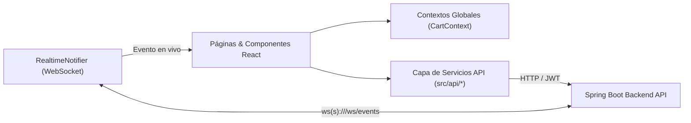

# Hurios Rally - Frontend Web Application

Aplicación Frontend moderna y responsiva construida con **React 19, TypeScript, Vite y Tailwind CSS 4** para el e-commerce de repuestos automotrices **Hurios Rally E.I.R.L.** Se integra con el Backend en Spring Boot mediante **REST API**, pasarela de pagos **MercadoPago Checkout Pro**, persistencia híbrida (**PostgreSQL + MongoDB Atlas**) y actualización de stock/eventos en tiempo real mediante **WebSockets**.

- **URL Desplegada (Render):** `https://huriosfrontend-desarrollofullstack.onrender.com`
- **Backend API Conectado:** `https://huriosbackend-desarrollofullstack.onrender.com`

---

## 1. Características Principales

- **Catálogo Interactivo y Filtros Dinámicos:** Búsqueda por texto, filtrado por categoría y rango de precios, y ordenamiento automático.
- **Reseñas y Calificaciones (MongoDB):** Cada tarjeta de producto (`ShopCard`) permite consultar el promedio de estrellas y publicar reseñas verificadas almacenadas en la colección `product_reviews` de MongoDB Atlas.
- **Carrito de Compras Sincronizado en la Nube (MongoDB):** Estado global gestionado con `CartContext` que sincroniza automáticamente los ítems del usuario con la colección `carts` en MongoDB (`GET/PUT/DELETE /cart` y fusión automática al iniciar sesión con `POST /cart/merge`).
- **Pasarela de Pagos Multi-Método (`Payment.tsx`):**
  - **Tarjeta de Crédito / Débito** con vista previa interactiva de tarjeta en vivo.
  - **Yape** con validación de código de aprobación.
  - **MercadoPago Checkout Pro** con generación de preferencias en el backend (`POST /payments/checkout`) y página de verificación de retorno (`PaymentResult.tsx` en `/pago/exito`, `/pago/fallo`, `/pago/pendiente`).
- **Actualizaciones en Tiempo Real con WebSockets (`RealtimeNotifier.tsx`):**
  - Conexión persistente al canal `ws(s)://<backend>/ws/events`.
  - Notificaciones emergentes en vivo cuando se registra una compra (`NEW_SALE`), cambia el stock (`STOCK_UPDATED`), se actualiza el catálogo (`PRODUCT_CREATED`/`PRODUCT_UPDATED`) o se publica una reseña (`NEW_REVIEW`).
  - Refresco automático del stock en las vistas de **Productos** e **Inventario** sin recargar la página.
- **Panel de Administración (RBAC):** Gestión de inventario, abastecimiento de stock, métricas de ventas y exportación de reportes a Excel.

---

## 2. Arquitectura del Frontend



### Estructura de Directorios (`src/`)
- `api/`: Clientes HTTP modulares (`auth.tsx`, `products.ts`, `cart.ts`, `payments.ts`, `reviews.ts`).
- `components/`: Componentes reutilizables (`layout/`, `product/ShopCard.tsx`, `realtime/RealtimeNotifier.tsx`, `ui/`).
- `config/`: Configuración centralizada de entorno (`api.ts`).
- `context/`: Estado global del carrito sincronizado con MongoDB (`CartContext.tsx`).
- `pages/`: Vistas de la aplicación (`Home`, `Products`, `Cart`, `Checkout`, `Payment`, `PaymentResult`, `Inventory`, `SalesHistory`, `AdminDashboard`, etc.).
- `routes/`: Definición de rutas públicas y protegidas (`AppRoutes.tsx`, `ProtectedRoute.tsx`).

---

## 3. Variables de Entorno

Crea un archivo `.env` en la raíz del proyecto basándote en `.env.example`:

| Variable | Descripción | Ejemplo Local | Ejemplo Producción (Render) |
| :--- | :--- | :--- | :--- |
| `VITE_API_URL` | URL base del Backend en Spring Boot (usada para llamadas REST y conexión WebSocket `/ws/events`) | `http://localhost:8080` | `https://huriosbackend-desarrollofullstack.onrender.com` |

---

## 4. Instrucciones de Instalación y Ejecución

### Requisitos Previos
- **Node.js** 18+ y **pnpm** (o npm)

### 1. Instalar dependencias
```bash
pnpm install
```

### 2. Ejecutar servidor de desarrollo (Vite)
```bash
pnpm dev
```
La aplicación estará disponible en `http://localhost:5173`.

### 3. Compilar para producción
```bash
pnpm build
```
Los archivos optimizados se generarán en la carpeta `dist/`.
